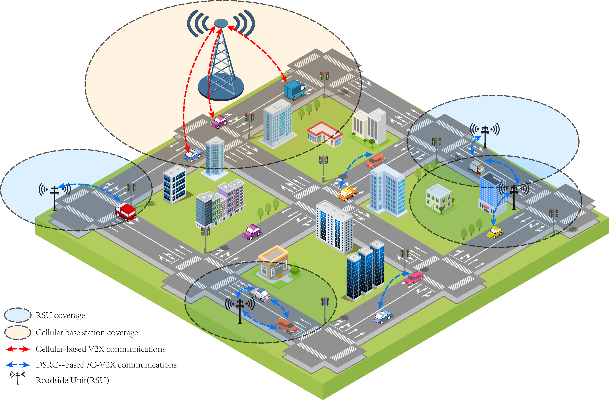
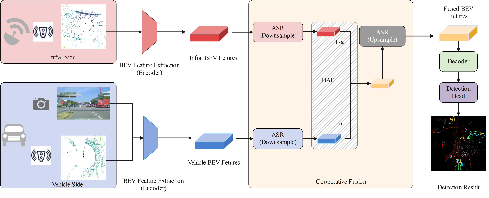
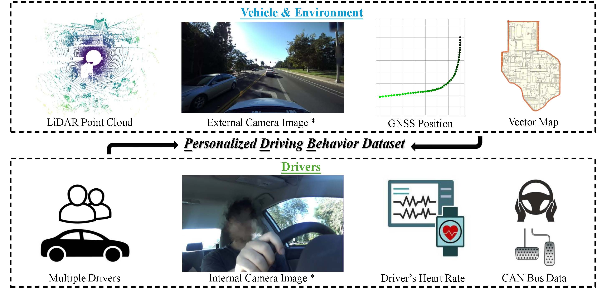
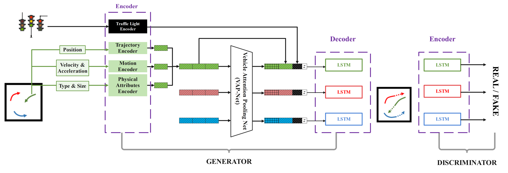

<section id="about">
<h2>About</h2>

I am an Applied Scientist at Amazon Prime Video. Previously, I was a Postdoctoral Researcher in the College of Engineering at Purdue University, working with <a href="https://ziranw.github.io/" target="_blank">Dr. Ziran Wang</a>. I received my Ph.D. from the Department of Electrical and Computer Engineering (ECE) at UC Riverside, co-advised by <a href="https://intra.ece.ucr.edu/~barth/" target="_blank">Dr. Matthew J. Barth</a> and <a href="https://profiles.ucr.edu/app/home/profile/guoyuanw" target="_blank">Dr. Guoyuan Wu</a>. I completed my Master's degree in Smart Connected and Autonomous Vehicles at the University of Warwick, UK, under the supervision of <a href="https://www.sems.qmul.ac.uk/staff/v.donzella" target="_blank">Dr. Valentina Donzella</a>.

My research focuses on autonomous driving perception and planning under challenging conditions: including vision-based and multi-sensor fusion perception in adverse environments, cooperative perception in V2X systems, trajectory prediction and planning in complex traffic scenarios, as well as personalized autonomous driving and vehicle re-identification.

</section>

<section id="experience">
<h2>Experience</h2>

  

    

    

Amazon Prime Video Current

Applied Scientist

Seattle, WA, US

    
10/2026 – Present

  

  

    

    

Purdue University

Postdoctoral Research Associate

West Lafayette, IN, US

    
05/2026 – 10/2026

  

  

    

    

Amazon

Applied Scientist Intern

Sunnyvale, CA, US

    
09/2025 – 12/2025

  

  

    

    

UC Riverside

Research Assistant

Riverside, CA, US

    
01/2023 – 05/2026

  

  

    

    

Onsemi

Computer Vision Research Assistant

Coventry, UK

    
11/2021 – 09/2022

  

</section>

<section id="education">
<h2>Education</h2>

  

    

    

University of California, Riverside

Ph.D.

Riverside, CA, US

    
10/2022 – 04/2026

  

  

    

    

University of Warwick

M.S.

Coventry, UK

    
10/2021 – 10/2022

  

  

    

    

Communication University of China

B.S.

Beijing, China

    
09/2013 – 07/2017

  

</section>

<section id="news">
<h2>News</h2>

  

    
11/2026

<a href="https://ieeexplore.ieee.org/document/11780732" target="_blank">Cooperative Perception: From Shared Sensing to Cooperative Intelligence</a> published in <a href="https://ieeexplore.ieee.org/xpl/RecentIssue.jsp?punumber=5117645" target="_blank">IEEE ITS Magazine</a>

    
10/2026

Started as an Applied Scientist at Amazon Prime Video

    
10/2026

Two papers accepted by <a href="https://wacv.thecvf.com/" target="_blank">WACV 2027</a>: <a href="https://arxiv.org/abs/2609.01799" target="_blank">Versatile Samples for Trajectory Scoring</a> and <a href="https://arxiv.org/abs/2609.08117" target="_blank">DriveMotion</a>

    
06/2026

Delivered an invited talk at the IV 2026 Interaction Workshop

    
05/2026

Started as a Postdoctoral Researcher at <a href="https://www.purdue.edu/" target="_blank">Purdue University</a>

    
05/2026

One paper accepted by <a href="https://ieee-itsc.org/2026/" target="_blank">ITSC 2026</a>

    
04/2026

Successfully defended <a href="https://www.linkedin.com/feed/update/urn:li:activity:7455670716835860480/" target="_blank">PhD dissertation</a> at UC Riverside

    
04/2026

Delivered an <a href="https://tbd.ctr.utexas.edu/seminar-webinar/intelligent-and-personalized-autonomous-driving-advancing-perception-cooperation-and-human-aware-prediction-systems/" target="_blank">invited talk</a> at ASU and UT Austin on V2X and personalized autonomous driving

    
02/2026

Book proposal titled "V2X-Enabled Cooperative Driving Systems" accepted by Springer Nature

    

    
01/2026

<a href="https://www.techrxiv.org/doi/full/10.36227/techrxiv.177203266.67901185" target="_blank">VLM Dataset Survey</a> accepted by <a href="https://ieee-iv.org/2026/" target="_blank">IEEE IV 2026</a>

    
09/2025

Started internship as Applied Scientist Intern at <a href="https://www.amazon.science/" target="_blank">Amazon</a>

    
09/2025

<a href="https://ieeexplore.ieee.org/abstract/document/11186152/" target="_blank">Cooperative Perception Survey</a> accepted in <a href="https://ieeexplore.ieee.org/xpl/tocresult.jsp?isnumber=4357935" target="_blank">Proceedings of the IEEE</a> (IF: 25.9)

    
08/2025

<a href="https://ieeexplore.ieee.org/abstract/document/11122292" target="_blank">One Paper</a> accepted in R-AL

    
07/2025

<a href="https://scholar.google.com/citations?view_op=view_citation&hl=en&user=LXwEufAAAAAJ&sortby=pubdate&citation_for_view=LXwEufAAAAAJ:KlAtU1dfN6UC" target="_blank">EKI-GAN</a> accepted by <a href="https://iccv.thecvf.com/" target="_blank">ICCV 2025</a> <a href="https://www.aicitychallenge.org/" target="_blank">AI City Workshop</a>

    
07/2025

<a href="https://arxiv.org/abs/2507.13677" target="_blank">HeCoFuse</a> and PointCompress3D accepted by <a href="https://ieee-itsc.org/2025/" target="_blank">ITSC 2025</a>

    
06/2025

Awarded 2025 UCR Esther F. Hays Graduate Fellowship

    
06/2025

<a href="https://arxiv.org/abs/2507.13677" target="_blank">HeCoFuse</a> ranked 1st in the <a href="https://drivex-workshop.github.io/" target="_blank">CVPR 2025 V2X Challenge</a>

    
03/2025

<a href="https://ieeexplore.ieee.org/document/11097396" target="_blank">One paper (Sensor Fusion Survey)</a> accepted by <a href="https://ieee-iv.org/2025/" target="_blank">IV 2025</a>

    
03/2025

One paper <a href="https://www.mdpi.com/2076-3417/15/7/3797" target="_blank">(VRU Survey)</a> accepted in <a href="https://www.mdpi.com/journal/applsci" target="_blank">Applied Sciences</a>

    
01/2025

Award <a href="https://its.dot.gov/isc/" target="_blank">USDOT Intersection Safety Challenge (Stage 1B)</a> Prize

    
12/2024

Passed Oral Exam and advanced to PhD candidacy

    
10/2024

Three papers accepted by <a href="https://trb-annual-meeting.nationalacademies.org/" target="_blank">TRB 2025</a> for presentation

    
09/2024

MappedPillars awarded Best Student Poster Runner-up Award at <a href="https://dsaa2024.dsaa.co/" target="_blank">DSAA 2024</a>

    
07/2024

<a href="https://ieeexplore.ieee.org/abstract/document/10920096" target="_blank">RAF-RCNN</a> accepted by <a href="https://ieee-itsc.org/2024/" target="_blank">ITSC 2024</a>

    
07/2024

Awarded 2024 UCR Esther F. Hays Graduate Fellowship

    
05/2024

<a href="https://openaccess.thecvf.com/content/CVPR2024W/AICity/html/Wei_KI-GAN_Knowledge-Informed_Generative_Adversarial_Networks_for_Enhanced_Multi-Vehicle_Trajectory_Forecasting_CVPRW_2024_paper.html" target="_blank">KI-GAN</a> accepted by <a href="https://cvpr.thecvf.com/Conferences/2024" target="_blank">CVPR 2024</a> <a href="https://www.aicitychallenge.org/" target="_blank">AI City Workshop</a>

    
05/2024

<a href="https://openaccess.thecvf.com/content/CVPR2024W/UG2/html/Wei_Feature_Corrective_Transfer_Learning_End-to-End_Solutions_to_Object_Detection_in_CVPRW_2024_paper.html" target="_blank">FCTR</a> accepted by <a href="https://cvpr.thecvf.com/Conferences/2024" target="_blank">CVPR 2024</a> <a href="https://cvpr2024ug2challenge.github.io/" target="_blank">UG2+ Workshop</a>

    
01/2024

<a href="https://ieeexplore.ieee.org/abstract/document/10485546" target="_blank">Dilemma Zone Survey</a> accepted by <a href="https://2023.ieee-itsc.org/" target="_blank">FISTS 2024</a>

    
11/2023

<a href="https://ieeexplore.ieee.org/abstract/document/10473585" target="_blank">One Paper</a> accepted by <a href="https://www.ieee-irc.org/" target="_blank">IRC 2023</a>

    
07/2023

<a href="https://ieeexplore.ieee.org/abstract/document/10422473" target="_blank">One Paper</a> accepted by <a href="https://2023.ieee-itsc.org/" target="_blank">ITSC 2023</a>

    
01/2023

Started as a Research Assistant (RA) at <a href="https://www.cert.ucr.edu/" target="_blank">CE-CERT</a>, <a href="https://www.ece.ucr.edu/" target="_blank">ECE</a>, <a href="https://www.ucr.edu/" target="_blank">UCR</a>

    
09/2022

Began PhD studies at <a href="https://www.ucr.edu/" target="_blank">UC Riverside</a>

    
10/2022

Graduated from <a href="https://warwick.ac.uk/" target="_blank">University of Warwick</a> with an MSc in <a href="https://warwick.ac.uk/fac/sci/wmg/study/masters-degrees/connected-autonomous-vehicles/" target="_blank">SCAV</a>

    
10/2021

Started MSc in <a href="https://warwick.ac.uk/fac/sci/wmg/study/masters-degrees/connected-autonomous-vehicles/" target="_blank">Smart, Connected and Autonomous Vehicles</a> at the <a href="https://warwick.ac.uk/" target="_blank">University of Warwick</a>

    

  

<button class="more" type="button" data-more="news-wrap" data-more-label="Show all 34 updates" data-less="Show fewer">Show all 34 updates</button>
</section>

<section id="publications">
<h2>Selected Publications</h2>

  <a class="selpub" href="/publications/">
    
    

Cooperative Perception for Automated Driving: A Survey of Algorithms, Applications, and Future Directions

<b>C. Wei</b>, G. Wu, M. J. Barth

Proceedings of the IEEE, vol. 114, no. 4, 2026

  </a>
  <a class="selpub" href="/publications/">
    
    

HeCoFuse: Cross-Modal Complementary V2X Cooperative Perception with Heterogeneous Sensors

<b>C. Wei</b>, Z. Qin, W. Zimmer, G. Wu, M. J. Barth

IEEE ITSC 2025

  </a>
  <a class="selpub" href="/publications/">
    
    

PDB: Not All Drivers Are the Same &mdash; A Personalized Dataset for Understanding Driving Behavior

<b>C. Wei</b>, Z. Qin, S. Li, Z. Zhang, X. Zhao, A. Abdelraouf, R. Gupta, K. Han, M. J. Barth, G. Wu

WACV 2027 Workshops (WAM-AD)

  </a>
  <a class="selpub" href="/publications/">
    
    

KI-GAN: Knowledge-Informed Generative Adversarial Networks for Enhanced Multi-Vehicle Trajectory Forecasting at Signalized Intersections

<b>C. Wei</b>, G. Wu, M. J. Barth, A. Abdelraouf, R. Gupta, K. Han

CVPR Workshops 2024

  </a>

<a class="viewall" href="/publications/">View all publications &rarr;</a>
</section>

<section id="service" class="svc">
<h2>Professional Service</h2>
<h3>Workshop organization &amp; committees</h3>

<a href="https://drivex-workshop.github.io/" target="_blank">DriveX Workshop</a> @ CVPR 2025, ICCV 2025, ITSC 2025, CVPR 2026 (Organizer); <a href="https://dliva-workshop.github.io/" target="_blank">Dliva Workshop</a> @ IEEE IV 2025 (Organizer); <a href="https://icrawearable.github.io/" target="_blank">1st WIHR Workshop</a> @ ICRA 2024 (Committee); <a href="https://coop-intelligence.github.io/" target="_blank">Coop-intelligence Workshop</a> @ ECCV 2024 (Committee)

<h3>Journal reviewer</h3>

<a href="https://ieee-itss.org/pub/t-its/" target="_blank" rel="noopener">T-ITS</a><a href="https://ieee-itss.org/pub/t-iv/" target="_blank" rel="noopener">T-IV</a><a href="https://vtsociety.org/publication/ieee-transactions-on-vehicular-technology" target="_blank" rel="noopener">TVT</a><a href="https://www.computer.org/csdl/journal/tm" target="_blank" rel="noopener">TMC</a><a href="https://www.computer.org/csdl/journal/tq" target="_blank" rel="noopener">TDSC</a><a href="https://ieee-itss.org/pub/oj-its/" target="_blank" rel="noopener">OJ-ITS</a><a href="https://ieeexplore.ieee.org/xpl/RecentIssue.jsp?punumber=8782711" target="_blank" rel="noopener">OJ-VT</a><a href="https://jmlr.org/tmlr/" target="_blank" rel="noopener">TMLR</a><a href="https://journals.sagepub.com/home/trr" target="_blank" rel="noopener">TRR</a><a href="https://peerj.com/computer-science/" target="_blank" rel="noopener">PeerJ CS</a><a href="https://www.tandfonline.com/journals/ucbs20" target="_blank" rel="noopener">C&amp;S</a><a href="https://www.mdpi.com/journal/sensors" target="_blank" rel="noopener">Sensors</a><a href="https://www.mdpi.com/journal/vehicles" target="_blank" rel="noopener">Vehicles</a><a href="https://www.mdpi.com/journal/telecom" target="_blank" rel="noopener">Telecom</a><a href="https://www.mdpi.com/journal/eng" target="_blank" rel="noopener">Eng</a><a href="https://www.aimspress.com/journal/era" target="_blank" rel="noopener">ERA</a><a href="http://itiis.org/" target="_blank" rel="noopener">KSII TIIS</a>

<h3>Conference reviewer</h3>

NeurIPSAAAICVPRECCVWACVICRAIROSIVITSCTRB Annual MeetingICVESFISTS

</section>

<section id="visitors">
<h2>Site Visitors</h2>

  

</section>
