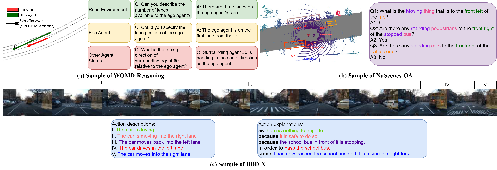
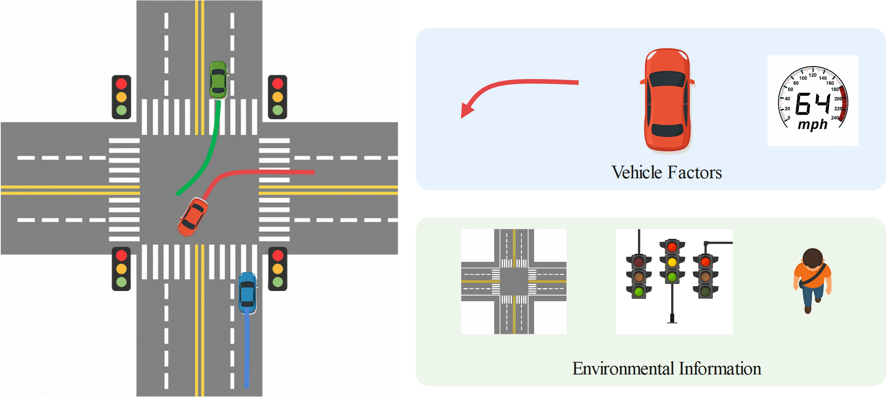
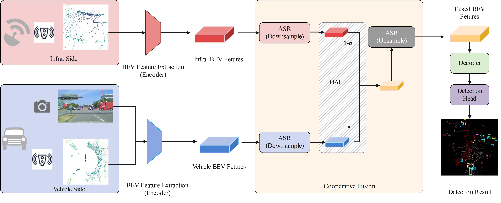
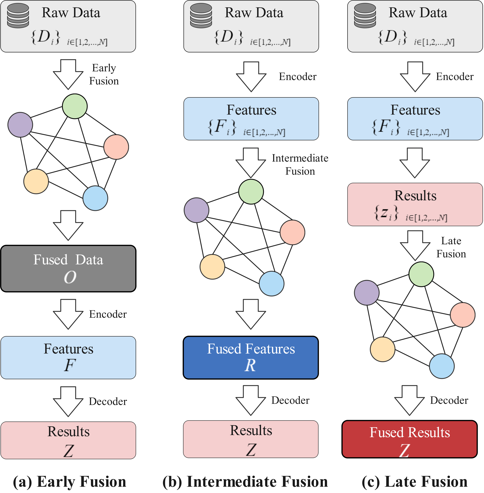
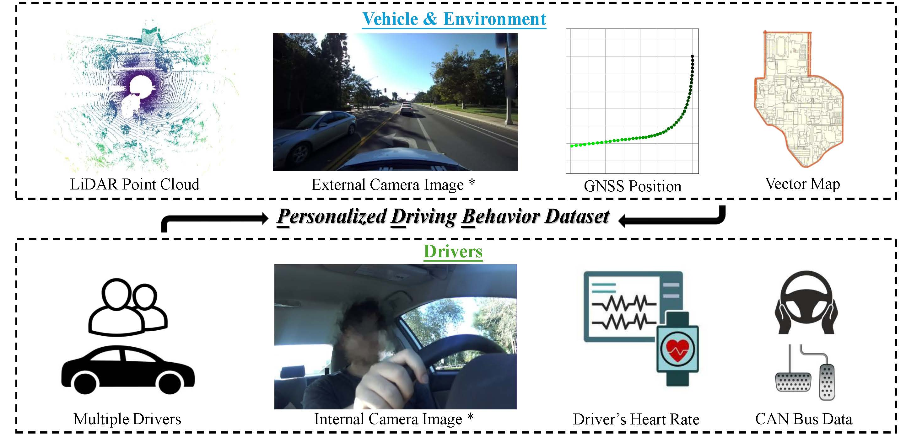
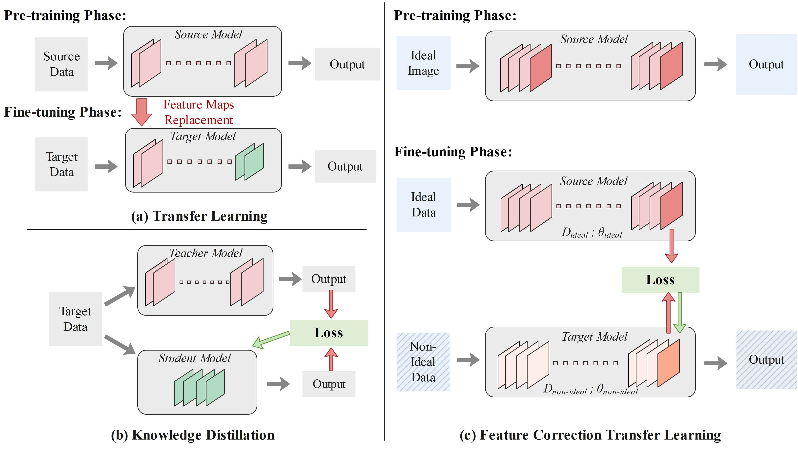
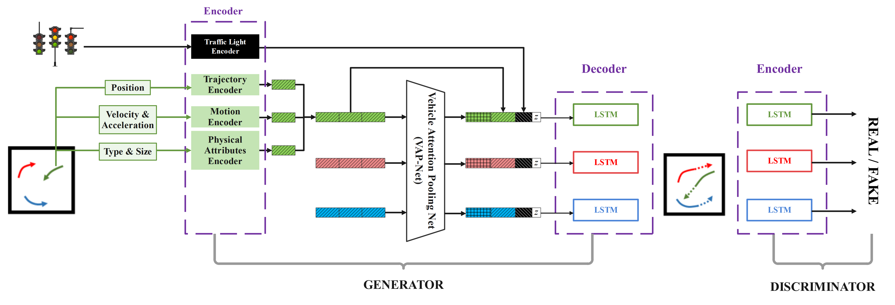
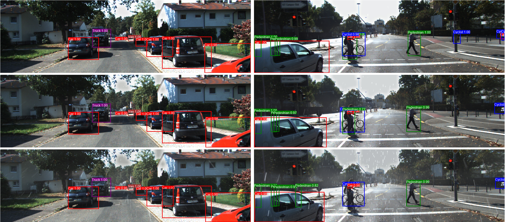
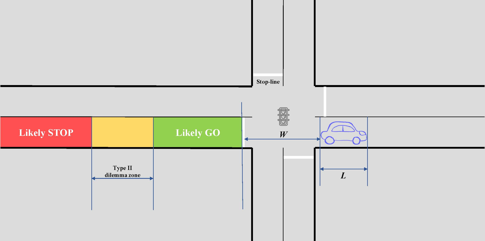
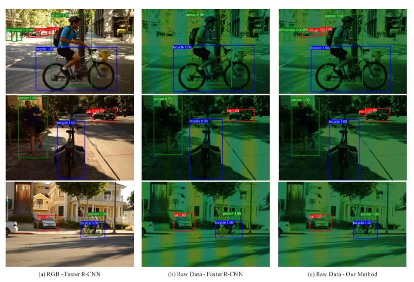

<section id="publications">
<h2>Publications</h2>

Selected peer-reviewed papers. A complete, up-to-date list is on <a href="https://scholar.google.com/citations?user=LXwEufAAAAAJ&amp;hl=en&amp;oi=ao" target="_blank" rel="noopener">Google Scholar</a>.

<!-- Cite modal -->

  

    <button onclick="closeCite()" class="cite-close" aria-label="Close">&times;</button>
    <h3>Cite</h3>
    <pre id="cite-modal-content"></pre>
    <button onclick="copyCite()" id="copy-btn" class="cite-copy">Copy</button>
  

  <!-- ===== 2026 ===== -->
  

    <h2 class="pub-year">2026</h2>

    

      

        
      

      

        
Cooperative Perception for Automated Driving: A Survey of Algorithms, Applications, and Future Directions

        
<strong class="me">C. Wei</strong>, G. Wu, and M. J. Barth

        
<em>Proceedings of the IEEE</em>, 2025 (Early Access)

        

          <a class="pub-btn" href="/files/PIEEE_Cooperative_Perception.pdf" target="_blank">PDF</a>
          <button class="pub-btn cite-btn" onclick="showCite('bib-2026-pieee')">Cite</button>
        

      

    

    
@article{wei2025cooperative,
  title={Cooperative perception for automated driving: A survey of algorithms, applications, and future directions},
  author={Wei, Chuheng and Wu, Guoyuan and Barth, Matthew J},
  journal={Proceedings of the IEEE},
  year={2025},
  publisher={IEEE}
}

    

      

        
      

      

        
Beyond Perception: A Survey and Future Directions of VLM-based Autonomous Driving Datasets

        
<strong class="me">C. Wei</strong>, H. Cheng, Z. Zhang, G. Wu, Z. Wang, and M. J. Barth

        
<em>2026 IEEE Intelligent Vehicles Symposium (IV)</em>

        

          <a class="pub-btn" href="/files/VLM_Dataset_Survey.pdf" target="_blank">PDF</a>
          <a class="pub-btn" href="https://www.techrxiv.org/doi/full/10.36227/techrxiv.177203266.67901185" target="_blank">TechRxiv</a>
          <button class="pub-btn cite-btn" onclick="showCite('bib-2026-iv')">Cite</button>
        

      

    

    
@inproceedings{wei2026beyond,
  title={Beyond Perception: A Survey and Future Directions of VLM-based Autonomous Driving Datasets},
  author={Wei, Chuheng and Cheng, Hao and Zhang, Ziyan and Wu, Guoyuan and Wang, Ziran and Barth, Matthew J},
  booktitle={2026 IEEE Intelligent Vehicles Symposium (IV)},
  year={2026},
  publisher={IEEE}
}

  

  <!-- ===== 2025 ===== -->
  

    <h2 class="pub-year">2025</h2>

    

      

        
      

      

        
EKI-GAN: Context-Aware Vehicle Trajectory Forecasting with Vehicle Factors and Environmental Information at Signalized Intersections

        
<strong class="me">C. Wei</strong>, G. Wu, and M. J. Barth

        
<em>Proceedings of the IEEE/CVF International Conference on Computer Vision (ICCV)</em>, 2025, pp. 5315–5324

        

          <a class="pub-btn" href="/files/EKI_GAN.pdf" target="_blank">PDF</a>
          <button class="pub-btn cite-btn" onclick="showCite('bib-2025-ekigan')">Cite</button>
        

      

    

    
@inproceedings{wei2025eki,
  title={EKI-GAN: Context-Aware Vehicle Trajectory Forecasting with Vehicle Factors and Environmental Information at Signalized Intersections},
  author={Wei, Chuheng and Wu, Guoyuan and Barth, Matthew},
  booktitle={Proceedings of the IEEE/CVF International Conference on Computer Vision},
  pages={5315--5324},
  year={2025}
}

    

      

        
      

      

        
HeCoFuse: Cross-Modal Complementary V2X Cooperative Perception with Heterogeneous Sensors

        
<strong class="me">C. Wei</strong>, Z. Qin, W. Zimmer, G. Wu, and M. J. Barth

        
<em>2025 IEEE 28th International Conference on Intelligent Transportation Systems (ITSC)</em>, pp. 1214–1221

        

          <a class="pub-btn" href="/files/HeCoFuse.pdf" target="_blank">PDF</a>
          <button class="pub-btn cite-btn" onclick="showCite('bib-2025-hecofuse')">Cite</button>
        

      

    

    
@INPROCEEDINGS{wei2025hecofuse,
  author={Wei, Chuheng and Qin, Ziye and Zimmer, Walter and Wu, Guoyuan and Barth, Matthew J.},
  booktitle={2025 IEEE 28th International Conference on Intelligent Transportation Systems (ITSC)},
  title={HeCoFuse: Cross-Modal Complementary V2X Cooperative Perception with Heterogeneous Sensors},
  year={2025},
  pages={1214-1221},
  doi={10.1109/ITSC60802.2025.11423237}
}

    

      

        
      

      

        
Integrating Multi-Modal Sensors: A Review of Fusion Techniques for Intelligent Vehicles

        
<strong class="me">C. Wei</strong>, Z. Qin, Z. Zhang, G. Wu, and M. J. Barth

        
<em>2025 IEEE Intelligent Vehicles Symposium (IV)</em>, pp. 1817–1824

        

          <a class="pub-btn" href="/files/IV_Sensor_fusion.pdf" target="_blank">PDF</a>
          <button class="pub-btn cite-btn" onclick="showCite('bib-2025-iv')">Cite</button>
        

      

    

    
@inproceedings{wei2025integrating,
  title={Integrating multi-modal sensors: a review of fusion techniques for intelligent vehicles},
  author={Wei, Chuheng and Qin, Ziye and Zhang, Ziyan and Wu, Guoyuan and Barth, Matthew J},
  booktitle={2025 IEEE Intelligent Vehicles Symposium (IV)},
  pages={1817--1824},
  year={2025},
  organization={IEEE}
}

    

      

        
      

      

        
PDB: Not All Drivers Are the Same — A Personalized Dataset for Understanding Driving Behavior

        
<strong class="me">C. Wei</strong>, Z. Qin, S. Li, Z. Zhang, X. Zhao, A. Abdelraouf, R. Gupta, K. Han, M. J. Barth, and G. Wu

        
<em>arXiv preprint</em> arXiv:2503.06477, 2025

        

          <a class="pub-btn" href="/files/PDB.pdf" target="_blank">PDF</a>
          <button class="pub-btn cite-btn" onclick="showCite('bib-2025-pdb')">Cite</button>
        

      

    

    
@article{wei2025pdb,
  title={PDB: Not All Drivers Are the Same--A Personalized Dataset for Understanding Driving Behavior},
  author={Wei, Chuheng and Qin, Ziye and Li, Siyan and Zhang, Ziyan and Zhao, Xuanpeng and Abdelraouf, Amr and Gupta, Rohit and Han, Kyungtae and Barth, Matthew J and Wu, Guoyuan},
  journal={arXiv preprint arXiv:2503.06477},
  year={2025}
}

  

  <!-- ===== 2024 ===== -->
  

    <h2 class="pub-year">2024</h2>

    

      

        
      

      

        
Feature Corrective Transfer Learning: End-to-End Solutions to Object Detection in Non-Ideal Visual Conditions

        
<strong class="me">C. Wei</strong>, G. Wu, and M. J. Barth

        
<em>Proceedings of the IEEE/CVF Conference on Computer Vision and Pattern Recognition Workshops (CVPRW)</em>, 2024, pp. 23–32

        

          <a class="pub-btn" href="/files/FCTL.pdf" target="_blank">PDF</a>
          <button class="pub-btn cite-btn" onclick="showCite('bib-2024-fctl')">Cite</button>
        

      

    

    
@inproceedings{wei2024feature,
  title={Feature corrective transfer learning: End-to-end solutions to object detection in non-ideal visual conditions},
  author={Wei, Chuheng and Wu, Guoyuan and Barth, Matthew J},
  booktitle={Proceedings of the IEEE/CVF Conference on Computer Vision and Pattern Recognition},
  pages={23--32},
  year={2024}
}

    

      

        
      

      

        
KI-GAN: Knowledge-Informed Generative Adversarial Networks for Enhanced Multi-Vehicle Trajectory Forecasting at Signalized Intersections

        
<strong class="me">C. Wei</strong>, G. Wu, M. J. Barth, A. Abdelraouf, R. Gupta, and K. Han

        
<em>Proceedings of the IEEE/CVF Conference on Computer Vision and Pattern Recognition Workshops (CVPRW)</em>, 2024, pp. 7115–7124

        

          <a class="pub-btn" href="/files/KI_GAN.pdf" target="_blank">PDF</a>
          <button class="pub-btn cite-btn" onclick="showCite('bib-2024-kigan')">Cite</button>
        

      

    

    
@inproceedings{wei2024ki,
  title={Ki-gan: Knowledge-informed generative adversarial networks for enhanced multi-vehicle trajectory forecasting at signalized intersections},
  author={Wei, Chuheng and Wu, Guoyuan and Barth, Matthew J and Abdelraouf, Amr and Gupta, Rohit and Han, Kyungtae},
  booktitle={Proceedings of the IEEE/CVF conference on computer vision and pattern recognition},
  pages={7115--7124},
  year={2024}
}

    

      

        
      

      

        
RAF-RCNN: Adaptive Feature Transfer from Clear to Rainy Conditions for Improved Object Detection

        
<strong class="me">C. Wei</strong>, G. Wu, and M. J. Barth

        
<em>2024 IEEE 27th International Conference on Intelligent Transportation Systems (ITSC)</em>, pp. 1418–1425

        

          <a class="pub-btn" href="/files/RAF_RCNN.pdf" target="_blank">PDF</a>
          <button class="pub-btn cite-btn" onclick="showCite('bib-2024-rafrcnn')">Cite</button>
        

      

    

    
@inproceedings{wei2024raf,
  title={RAF-RCNN: Adaptive Feature Transfer from Clear to Rainy Conditions for Improved Object Detection},
  author={Wei, Chuheng and Wu, Guoyuan and Barth, Matthew J},
  booktitle={2024 IEEE 27th International Conference on Intelligent Transportation Systems (ITSC)},
  pages={1418--1425},
  year={2024},
  organization={IEEE}
}

    

      

        
      

      

        
Dilemma Zone: A Comprehensive Study of Influential Factors and Behavior Analysis

        
<strong class="me">C. Wei</strong>, Z. Qin, G. Wu, M. J. Barth, A. Abdelraouf, R. Gupta, and K. Han

        
<em>2024 Forum for Innovative Sustainable Transportation Systems (FISTS)</em>, pp. 1–8

        

          <a class="pub-btn" href="/files/Dilemma_Zone.pdf" target="_blank">PDF</a>
          <button class="pub-btn cite-btn" onclick="showCite('bib-2024-dilemma')">Cite</button>
        

      

    

    
@inproceedings{wei2024dilemma,
  title={Dilemma zone: A comprehensive study of influential factors and behavior analysis},
  author={Wei, Chuheng and Qin, Ziye and Wu, Guoyuan and Barth, Matthew J and Abdelraouf, Amr and Gupta, Rohit and Han, Kyungtae},
  booktitle={2024 Forum for Innovative Sustainable Transportation Systems (FISTS)},
  pages={1--8},
  year={2024},
  organization={IEEE}
}

  

  <!-- ===== 2023 ===== -->
  

    <h2 class="pub-year">2023</h2>

    

      

        
      

      

        
Enhanced Object Detection by Integrating Camera Parameters into Raw Image-Based Faster R-CNN

        
<strong class="me">C. Wei</strong>, G. Wu, M. Barth, P. H. Chan, V. Donzella, and A. Huggett

        
<em>2023 IEEE 26th International Conference on Intelligent Transportation Systems (ITSC)</em>, pp. 4473–4478

        

          <a class="pub-btn" href="/files/Bayer_ITSC2023.pdf" target="_blank">PDF</a>
          <button class="pub-btn cite-btn" onclick="showCite('bib-2023-bayer')">Cite</button>
        

      

    

    
@inproceedings{wei2023enhanced,
  title={Enhanced object detection by integrating camera parameters into raw image-based faster r-cnn},
  author={Wei, Chuheng and Wu, Guoyuan and Barth, Matthew and Chan, Pak Hung and Donzella, Valentina and Huggett, Anthony},
  booktitle={2023 IEEE 26th international conference on intelligent transportation systems (ITSC)},
  pages={4473--4478},
  year={2023},
  organization={IEEE}
}

  

</section>
